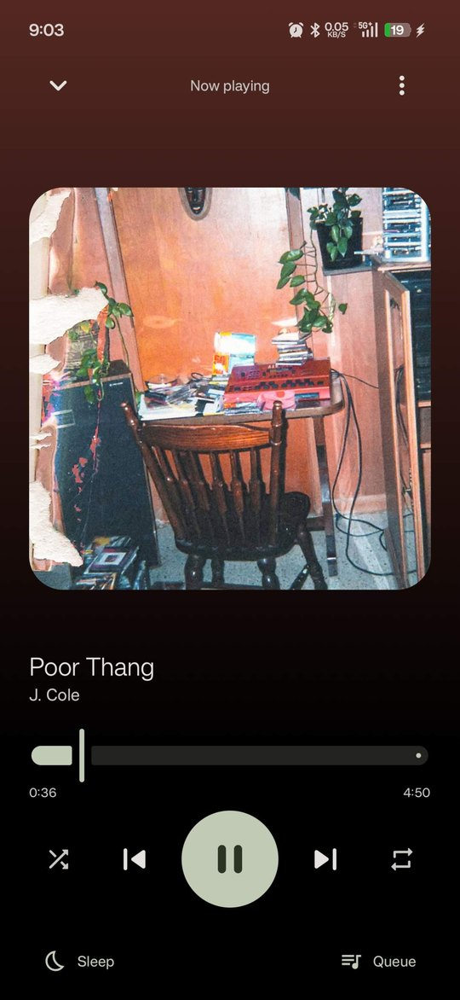
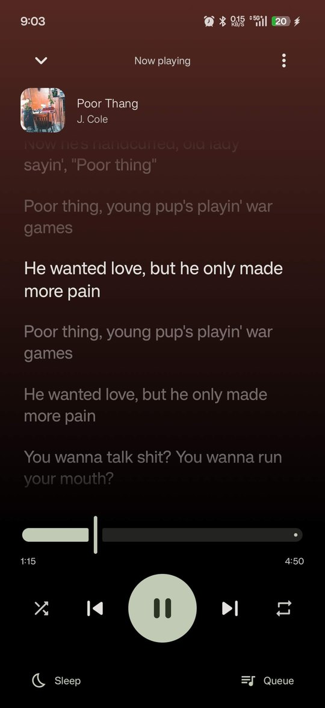
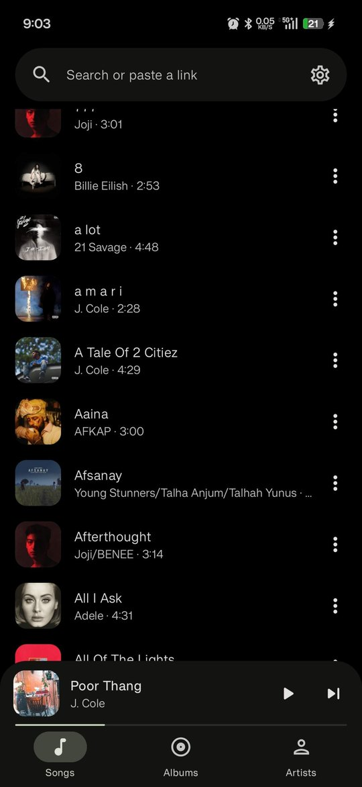
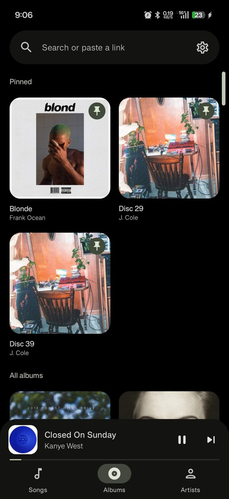
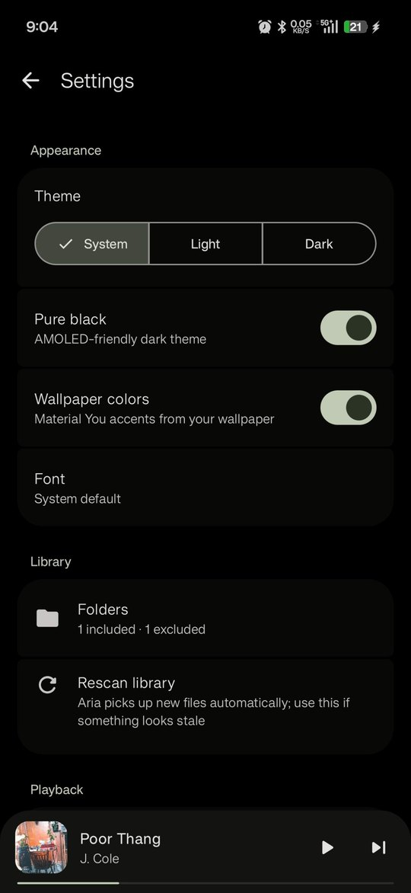

# Aria

A lean, native Android music player for local files. Kotlin, Jetpack Compose, Material 3, Media3.

**Download:** [latest release](https://github.com/savar95x/aria-player/releases/latest) ([direct APK](https://github.com/savar95x/aria-player/releases/latest/download/aria.apk)). Every push to `main` publishes a numbered release with its changes listed. Builds share a signing key, so each one installs over the last.

<p align="center">
  
  
  
  
  
</p>

## What's in it

- **Material 3 + AMOLED.** Wallpaper colours (Material You), pure black dark theme, light/dark/system.
- **Any Google Font.** Pick from a shortlist or type any family name from fonts.google.com.
- **Home-screen widget.** Blurred-artwork backdrop. Resizes from 2×2 (art + play) to 4×2 and 4×4 (art, titles, controls). Works after a reboot without opening the app.
- **Sleep timer.** Fades out, or waits for the current song to finish. Extend by +10 min.
- **Folder include/exclude.** Whitelist and blacklist together; the most specific rule wins.
- **Fix tags online.** Search a song, pick the match, and Aria writes title/artist/album/year/genre/track and 1200px cover art into the file.
- **Synced lyrics.** From the file's tags or LRCLIB, cached for offline; tap a line to jump there.
- **Play links.** Paste or share any audio / stream URL (mp3, HLS, internet radio).
- **Pinned albums**, a draggable queue, real shuffle, fast scroller, Material 3 Expressive motion.
- Songs / Albums / Artists, search, shuffle/repeat. Remembers the queue and position across restarts. Headset play button resumes the last session.

## Building

Open in Android Studio, or `./gradlew assembleRelease`. Min SDK 31 (Android 12).

## Layout

```
app/src/main/java/dev/savar/aria/
  data/       MediaStore library, folder rules, settings, saved queue
  playback/   Media3 service, sleep timer, notification artwork
  metadata/   iTunes Search lookup, jaudiotagger tag writer
  widget/     Glance home-screen widget
  ui/         Compose screens and theme
```
