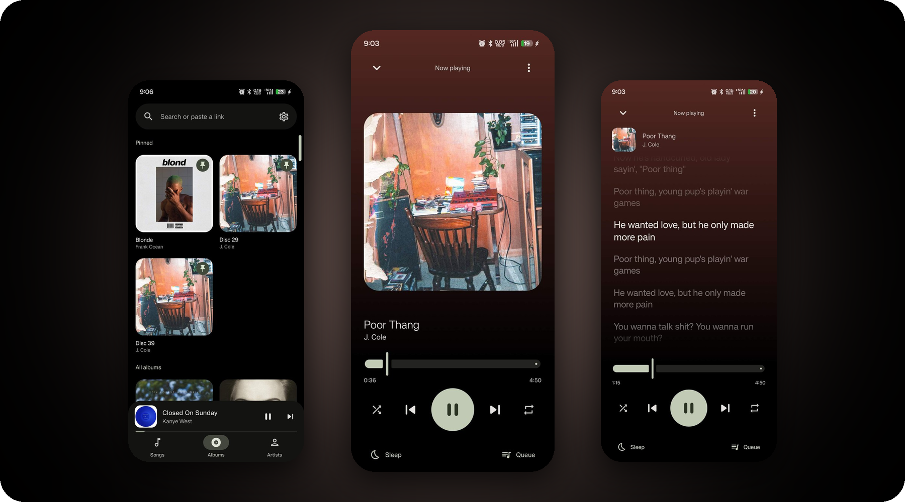

<p align="center"></p>

<h1 align="center">Aria</h1>

<p align="center">A lean, native Android music player for local files.<br/>Kotlin · Jetpack Compose · Material 3 Expressive · Media3</p>

<p align="center">
  <a href="https://github.com/savar95x/aria-player/releases/latest/download/aria.apk"><b>Download APK</b></a>
  &nbsp;·&nbsp;
  <a href="https://github.com/savar95x/aria-player/releases">All releases</a>
</p>

<p align="center"></p>

Every push to `main` publishes a numbered release with its changes listed. Builds share a signing key, so each one installs over the last.

## What's in it

- **Material 3 + AMOLED.** Wallpaper colours (Material You), pure black dark theme, light/dark/system, adjustable corner roundness.
- **Any Google Font.** Search every Google Font, previewed in itself, then adjust size, weight and letter spacing.
- **Home-screen widget.** Blurred-artwork backdrop. Resizes from 2×2 (art + play) to 4×2 and 4×4 (art, titles, controls). Plain RemoteViews pushed straight from the player, so it's light and works after a reboot without opening the app.
- **Sleep timer.** Fades out, or waits for the current song to finish. Extend by +10 min.
- **Folder include/exclude.** Whitelist and blacklist together; the most specific rule wins.
- **Fix tags online.** Search a song, pick the match, and Aria writes title/artist/album/year/genre/track and 1200px cover art into the file.
- **Synced lyrics.** From the file's tags or LRCLIB, cached for offline; tap a line to jump there.
- **Play links.** Paste or share any audio / stream URL (mp3, HLS, internet radio).
- **Artist photos.** Matched through the albums you own (so it's the right Adele). Tap to zoom; pick another online photo, one from your gallery, or keep album art.
- **Pinned albums**, a draggable queue, real shuffle, sorting on every tab, fast scroller, Material 3 Expressive motion.
- Songs / Albums / Artists, search, shuffle/repeat. Remembers the queue and position across restarts. Headset play button resumes the last session.
- **In-app updates.** A card under the search bar when a new version is out; one tap downloads and installs it.

<details>
<summary><b>More screenshots</b></summary>
<br/>
<p align="center">
  
  &nbsp;&nbsp;
  
</p>
</details>

## Part of a family

<p align="center"></p>

Four small Android apps built to look and behave like one set: same icon palette, Material 3 Expressive with your
wallpaper's colours, pure black mode, any Google Font for the app, the same settings layout, and in-app updates
from GitHub Releases.

| | |
|---|---|
| [**Aria**](https://github.com/savar95x/aria-player) | Music player for your local files |
| [**Minutia**](https://github.com/savar95x/minutia) | Clock widget where every detail is yours |
| [**Hiatus**](https://github.com/savar95x/hiatus) | How long you've been away from your phone |
| [**Regista**](https://github.com/savar95x/regista) | Reminders for the football matches you care about |

## Building

Working on the code (person or AI agent)? Start with [AGENTS.md](AGENTS.md).


Open in Android Studio, or `./gradlew assembleRelease`. Min SDK 31 (Android 12).

## Layout

```
app/src/main/java/dev/savar/aria/
  data/       MediaStore library, folder rules, settings, saved queue
  playback/   Media3 service, sleep timer, notification artwork
  metadata/   iTunes Search lookup, jaudiotagger tag writer
  widget/     RemoteViews home-screen widget
  ui/         Compose screens and theme
```
