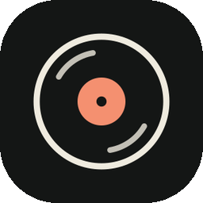

# Aria app icon: design spec

A record, drawn as little as possible. Same palette as the owner's Minutia icon, so the two read as a set.

## Shapes (108 dp adaptive canvas, centred at 54,54)
| Shape | Spec | Colour |
|---|---|---|
| Rim | circle r 23, stroke 2.2 | cream `#EFEBDF` |
| Glints (light on the vinyl) | two arcs on r 17.5, -150°→-100° and 30°→80°, stroke 2, round caps, 80% alpha | cream |
| Label | filled circle r 8.5 | coral `#F49070` |
| Spindle hole | circle r 1.8 | ink |
| Background | flat | ink `#141615` |

Monochrome layer: the same shapes in one colour, spindle hole cut out of the label (even-odd).
Files: `app/src/main/res/drawable/ic_launcher_{background,foreground,monochrome}.xml`, edited by hand.

## Rules
- Cream, coral, ink only. No gradients, shadows, extra marks (a tonearm was tried: too fussy).
- Keep everything inside the 66 dp safe circle (rim outer edge is r 24.1).

## History
| Design | Outcome |
|---|---|
| White equaliser bars on black | Generic |
| Cream "a" with play button in the bowl, purple gradient | Disliked |
| Rounded-stroke "a" with coral dot in the bowl | Too bold |
| Inter Display "a." (ExtraBold, then SemiBold) | Disliked |
| **Record: cream rim + glints, coral label, on ink** | **Current** (owner picked the record direction from six sketches) |
